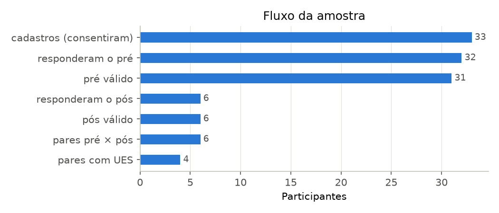
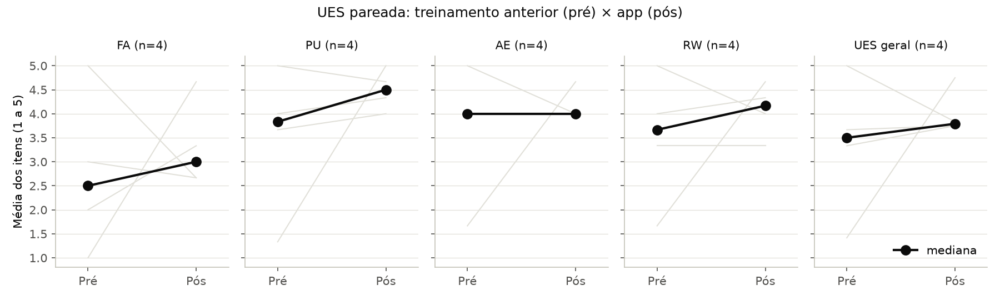
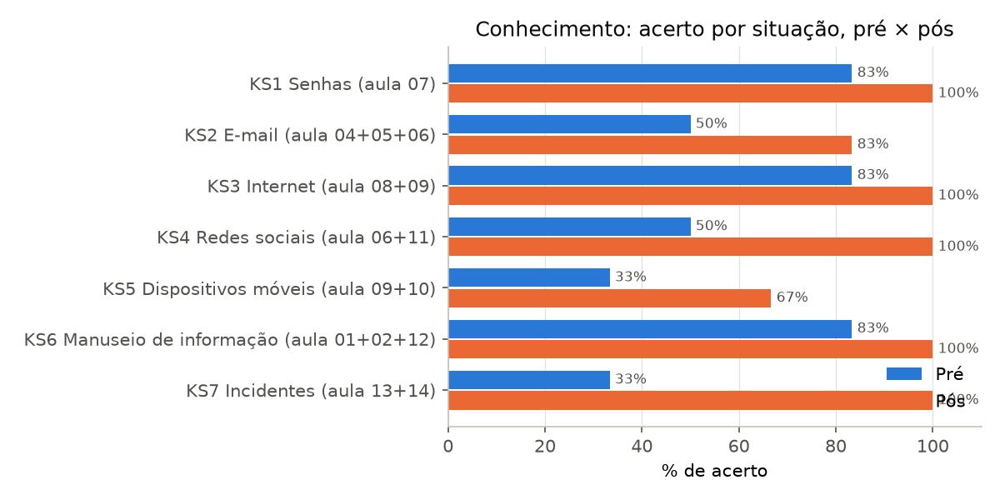
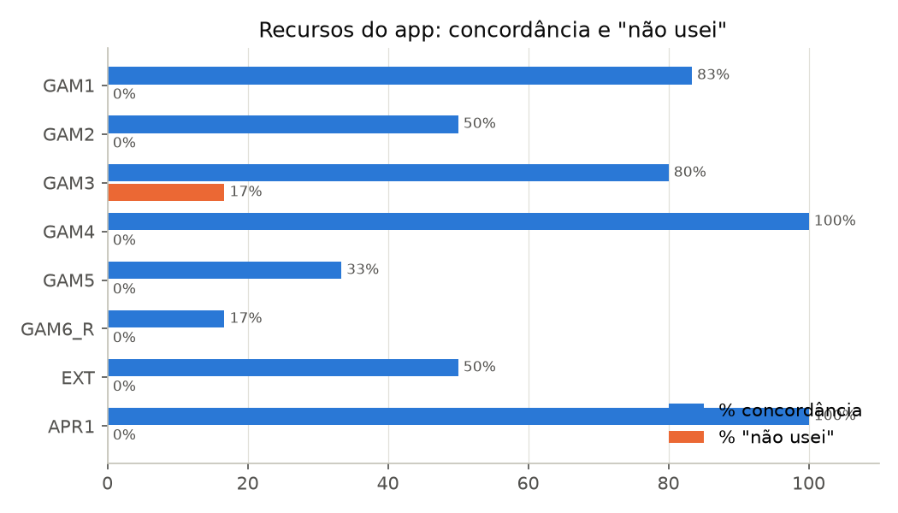

# Avaliação do Guardião Impacta: resumo para o TCC

Gerado pelo analise.py a partir dos dados da pasta; tabelas completas em apendice.md. Sem grupo de controle: é associação, não causa.

## 1. Amostra e qualidade dos dados

| etapa | n |
|---|---|
| cadastros (consentiram) | 33 |
| responderam o pré | 32 |
|   − errou o ATN no pré | 1 |
| pré válido | 31 |
| responderam o pós | 6 |
|   − errou o ATN no pós | 0 |
| pós válido | 6 |
|   − pré depois da 1ª atividade no app | 0 |
|   − sem pré válido | 0 |
| pares pré × pós | 6 |
|   − sem UES pareada (C1 ≠ Sim) | 2 |
| pares com UES | 4 |
| envios repetidos descartados (vale o primeiro) | 0 |

Confiabilidade da UES geral (α de Cronbach): pre 0.95 (n = 16); pos 0.89 (n = 6).
Hexad, só para descrever a amostra (média da soma por tipo, de 2 a 14): Filantropo 12.3, Socializador 9.9, Conquistador 11.9, Jogador 11.5, Espirito_livre 12.5.
Abandono: 6 de 26 elegíveis responderam o pós. Maiores diferenças entre quem respondeu e quem não respondeu (uso na mesma janela, até 14 dias após o pré): aulas_concluidas r = +0.73 (grande; medianas 15.0 × 1.0); dias_ativos r = +0.73 (grande; medianas 4.5 × 1.0) (exploratório, sem correção).
Resposta uniforme (mesma nota em todos os itens do bloco): Hexad 2. Só marcado, não excluído (lista em marcados.csv).

## 2. Engajamento e percepção

| medida | n_pares | mediana_pre | mediana_pos | r_rank_biserial | r_ic95_inf | r_ic95_sup | p_holm |
|---|---|---|---|---|---|---|---|
| UES geral | 4 | 3.5 | 3.792 | 0.4 |  |  | 0.625 |
| FA | 4 | 2.5 | 3 |  |  |  |  |
| PU | 4 | 3.833 | 4.5 |  |  |  |  |
| AE | 4 | 4 | 4 |  |  |  |  |
| RW | 4 | 3.667 | 4.167 |  |  |  |  |

Entre quem já tinha feito treinamento (n = 4), o engajamento (UES geral) não mudou de forma clara: mediana de 3.50 para 3.79. Efeito médio (r = +0.40; p Holm = 0.625).
Comparado ao treinamento anterior (CMP, sem "não lembro"), o app foi: Muito pior 0%, Pior 0%, Igual 25%, Melhor 50%, Muito melhor 25%.
O pré avalia o treinamento anterior e o pós, o app: são experiências diferentes, então é associação, não causa. Subescalas só descritivas.

## 3. Conhecimento

| item | area | n | pct_acerto_pre | pct_acerto_pos | pct_erro_pre | pct_erro_pos | pct_nao_sei_pre | pct_nao_sei_pos |
|---|---|---|---|---|---|---|---|---|
| KS1 | Senhas | 6 | 83.333 | 100 | 16.667 | 0 | 0 | 0 |
| KS2 | E-mail | 6 | 50 | 83.333 | 33.333 | 0 | 16.667 | 16.667 |
| KS3 | Internet | 6 | 83.333 | 100 | 0 | 0 | 16.667 | 0 |
| KS4 | Redes sociais | 6 | 50 | 100 | 33.333 | 0 | 16.667 | 0 |
| KS5 | Dispositivos móveis | 6 | 33.333 | 66.667 | 66.667 | 33.333 | 0 | 0 |
| KS6 | Manuseio de informação | 6 | 83.333 | 100 | 0 | 0 | 16.667 | 0 |
| KS7 | Incidentes | 6 | 33.333 | 100 | 33.333 | 0 | 33.333 | 0 |

Entre os pareados (n = 6), o conhecimento (acertos nas 7 situações, de 0 a 7) não mudou de forma clara: mediana de 4.00 para 6.50. Efeito grande (r = +1.00, IC 95% de +1.00 a +1.00; p Holm = 0.125).
Nível de conhecimento (descritivo; acertos baixo 0–2, médio 3–4, alto 5–7): no pré, baixo (0–2) 1, médio (3–4) 6, alto (5–7) 24; no pós, baixo (0–2) 0, médio (3–4) 0, alto (5–7) 6. No pré, quem errou mais escolheu uma opção "responsável" errada (12) ou admitiu não saber (4); perfis por grupo no apêndice.
Complementar (exploratório, fora da correção de Holm): dentro da mesma pessoa (n = 1), o ganho nos itens das aulas que ela concluiu teve mediana +0.40, contra +0.00 nos demais: efeito grande (r = +1.00).
Variação do conhecimento × uso até o pós, controlando os dias entre os questionários (Spearman parcial): aulas_concluidas ρ = +0.35 (médio, n = 6); dias_ativos ρ = +0.20 (pequeno, n = 6) (exploratório, sem correção).
Responder o mesmo teste duas vezes também pode melhorar a nota; a comparação dentro da pessoa ajuda a separar isso; é associação, não causa.

## 4. Gamificação e uso

| item | n | pct_concordancia | pct_nao_usei |
|---|---|---|---|
| GAM1 | 6 | 83.333 | 0 |
| GAM2 | 6 | 50 | 0 |
| GAM3 | 6 | 80 | 16.667 |
| GAM4 | 6 | 100 | 0 |
| GAM5 | 6 | 33.333 | 0 |
| GAM6_R | 6 | 16.667 | 0 |
| EXT | 6 | 50 | 0 |
| APR1 | 6 | 100 | 0 |

Recurso que mais motivou (MOT): Conquistas 1, Ranking 3, Explicações depois das respostas 2.
Uso até o pós (33 participantes): mediana de 1 dias ativos e 2 aulas concluídas; por faixa de aulas, 0–4: 21, 5–10: 1, 11–15: 11.
O que a pessoa diz acompanha o uso? GAM2 × visitas_ranking: ρ = +0.73 (grande, n = 6); GAM1 × pontos: ρ = +0.17 (pequeno, n = 6). Exploratório; associação, não causa.
Tipo Hexad dominante × recurso mais motivador e perfil Hexad × uso registrado: tabelas no apêndice (exploratório e descritivo, sem teste para o MOT e sem correção para o uso; o perfil × uso ainda não está descrito no texto do TCC). No perfil × uso, 2 par(es) redundante(s) com as aulas concluídas (|ρ| >= 0.9): não é evidência independente de Conquistador × aulas.

O que disseram (escolhidas por faixa de uso):

- "A dinâmica de pontuações e ranking me gerou um espírito de competitividade, que não se sustentou ao longo do período a ser dedicado ao curso, pela questão citada na pergunta anterior, mas houve sim um despertar de competição que, por um período, fez eu permanecer no app." (ABR1, faixa 5–10 aulas)
- "Nada! 
Aplicativo está bem bacana, ele está dinâmico." (ABR2, faixa 11–15 aulas)
- "O conteúdo é interessante 
Linguagem fácil de entender" (ABR1, faixa 11–15 aulas)
- "Mais enxuto e auto descritivo" (ABR2, faixa 11–15 aulas)
